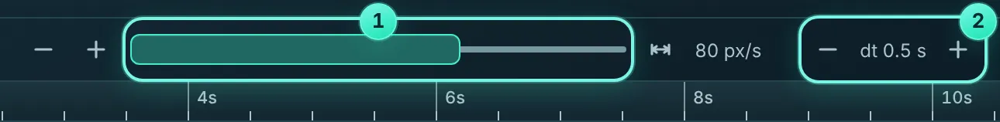

# Capturing the app

The pictures of the documentation are taken from the real app by a tool, never by hand: a page
that shows the app has a **capture file**, `tools/captures/<page-id>.mjs`, and
`tools/capture.mjs` runs it and writes what it makes into `media/<page-id>/`. When the app
changes, the same command takes every picture again, in both themes of the app.

A capture file holds **items** of four kinds:

| Kind | What it makes | Files in `media/<page-id>/` |
| --- | --- | --- |
| `shot` | a screenshot: the window, an element or a rectangle, with rings and numbers if asked | `<name>.dark.webp`, `<name>.light.webp` |
| `clip` | a short silent video of an interaction, with a visible pointer and the keys pressed | `<name>.dark.webm` + poster `<name>.dark.webp`, the same in light |
| `tour` | a sequence of steps: an image, a caption and the boxes of what each step is about | `<name>-<n>.dark.webp` / `.light.webp`, `<name>.tour.js` |
| `data` | JSON read out of the app (its shortcut sheet, its menus…) for reference pages | `<name>.data.js` |

Every folder also gets a `manifest.json`: each file with its CSS width and height, its density and
its size in bytes. Nothing in `media/` is edited by hand.

## Running it

From the repository's root (any working directory works):

```bash
node docs/web/tools/capture.mjs                           # every capture file
node docs/web/tools/capture.mjs basics/timeline           # one page
node docs/web/tools/capture.mjs basics                    # a section: every page of basics/
node docs/web/tools/capture.mjs basics/timeline --only move-clip --theme dark
node docs/web/tools/capture.mjs --list                    # what each file makes; no browser
node docs/web/tools/capture.mjs --sizes                   # bytes per page and item; no browser
```

- `--only <name>[,<name>…]` captures only those items (by name); `--theme dark|light` only one
  theme (both by default). Every run, even of some items or of one theme, also removes from the
  page's folder and its manifest the media that no item of the capture file makes any more (an
  item renamed or deleted, a tour with fewer images), and names them; the files of the other items
  stay.
- The run goes through `withChrome` of `tools/lib/`: it takes a slot of the machine (a few heavy
  runs at a time, in the order they came; it says for whom it waits), waits while the CPU is at
  85 °C or more and stops everything at 95 °C, starts the app's dev server on the slot's port
  (5191, 5192…) and the system's Chrome, and stops both at the end. Never start them another way.
- The capture files are read **when the run gets its slot**, not when it is launched: a file edited
  while its run waits for its turn is captured as edited. (They are also checked at once, before
  the wait, so that a mistake is said without waiting.)
- At the end it prints every file of the pages it ran — size in CSS px, density, length of a clip,
  bytes — with a warning above the budgets, and the size of the whole of `docs/web/`. A clip longer
  than 6 s is named in a warning (not a failure): trim it to the action, or set `maxSeconds` on the
  item if it must be long.
- `--sizes` prints, from the manifests and without a browser, what each page weighs: per item, its
  bytes in the dark and the light theme, the heaviest first, the clips that are too long, and the
  whole of `docs/web/` against its target (about 35 to 45 MB). It takes page ids or sections like
  a run; with none, every page, and the media folders no capture file makes.
- A capture file is checked before Chrome starts: an unknown field, a wrong name, a caption with
  HTML it may not have, a project it may not open, two items writing the same file — every
  problem is listed at once. `--check` does only that (and checks `--only`'s names), and prints
  nothing when all is well. During the run a failing item is reported and the others go on; the
  command then exits with 1.
- A failing item leaves what there is to look at, in a folder of the system's temporary directory
  that the message names (`mfe-capture-failures/<page-id>/`, never `media/`):
  `<item>.<theme>.png`, the whole window when it failed, and `<item>.<theme>.txt`, the error, the
  page errors and console errors of that item, and the state of the app — the playhead, the
  selection, the dialogs and menus open, the focus, the formulas not rendered.
- Page errors of the app and its console errors are printed as warnings (but for its looking for
  the companion on port 7799, which the tools never start): they may be bugs worth reporting.
- It takes a few seconds per item and theme (a clip: its length, then a few seconds of encoding).

### Without ffmpeg

Clips are encoded by **ffmpeg** with its VP9 encoder (`libvpx-vp9`), when `ffmpeg` is on the
PATH. Without it the tool makes no clip — no video and no poster —, says so, keeps the files a
clip already has in `media/`, and does not count them as stale. Screenshots, tours and data need
nothing but Chrome: their WebP is encoded by Chrome itself.

## A capture file

```js
/* Captures of basics/timeline: … */
export default {
  page: 'basics/timeline',                              // = the file's path under captures/
  project: 'examples/completing-the-square.mfe.json',   // default of every item
  viewport: { width: 1440, height: 900 },               // default; this is the default anyway
  items: [
    { kind: 'shot', name: 'window', setup: async (page, kit) => { await kit.seek(13.1); } },
    // …
  ],
};
```

- `page` is the page's id — its path without `.html` — and must be the file's path under
  `tools/captures/`: `tools/captures/basics/timeline.mjs` is `basics/timeline`.
- `project` is a path of the repository: an example that git tracks in `examples/` (the owner
  keeps projects of their own there too: those are refused) or one of `docs/web/examples/`. An
  item without a project opens the app's new, empty project.
- Item names are lowercase words joined by hyphens, unique in the file; they name the files.
- A capture file imports nothing from the tool: it gets the Playwright `page` and the `kit` (below)
  as arguments. The samples are the best start: `captures/start/interface.mjs` (a tour and a
  window), `captures/basics/timeline.mjs` (a clip and a shot with numbered rings),
  `captures/reference/shortcuts.mjs` and `captures/reference/menus.mjs` (data).

### Helpers shared by capture files

What two capture files both need goes in `tools/captures/_shared/<topic>.mjs`, and each imports it
(`import { companionOnline } from '../_shared/companion.mjs';`) rather than another page's capture
file or a copy of it. A file or folder whose name starts with `_` is no page: the tool does not run
it, nor list it, nor make a media folder for it. A helper says in its header what it is for, and
most take `(page, kit, …)` like a step. There are eight:

- `_shared/companion.mjs`: `companionOnline(page, kit, { health })` makes the app see a companion
  online — it answers the app's `GET /health` itself (`HEALTH`, a companion 1.6 with ffmpeg and
  both Manims, or `healthWith({ … })`) and refuses every other request —, for the figures that
  need one: the tools never start the companion.
- `_shared/creator-panel.mjs`: `widenCreator(page, kit, by)` drags the bar between the Creator and
  the Preview `by` px to the right, so that the cards have room for their names.
- `_shared/relation-editor.mjs`: how the relation pages open a relation editor, as steps:
  `openEditor(id)` on a relation, `createEditor(from, to)` on a new one between two clips, and
  `newRelation(from, to)` the same once the example's own relations are taken away; and
  `expectLayout(prefix, layout)`, which warns when the drawing of a pair editor (`'rel'` or
  `'morph'`) opened stacked where the page says side by side, or the other way round, and
  `showWholeDrawing(prefix)`, which presses its «Fit» when it opened framed on a part of it.
- `_shared/formula-steps.mjs`: the steps a reader does through the interface alone — write a
  formula, put its clip on a track, give it an intro, relate two clips — for start/first-animation,
  basics/first-transform and tutorials/linear-equation; `currentProject(kit)` hands back the
  project the app holds, for the scripts that make the pages' examples.
- `_shared/path-editing.mjs`: the Edit-path mode of the Preview — open it on a pair, read where the
  anchors and handles of its curve are, shape the curve — for transforms/custom-paths and the two
  steps files below.
- `_shared/annotated-identity.mjs`: the steps of tutorials/annotated-identity on its starting
  project, for its capture file and for two steps files that derive examples
  (`tutorials/_annotated-identity.steps.mjs`, `objects/_braces-labelled.steps.mjs`); these take
  `(kit, page, …)`.
- `_shared/steps-custom-paths-swap.mjs`, `_shared/steps-custom-paths-compare.mjs`: the gestures
  that make those two examples from their starting projects (`examples.mjs derive … --steps`).

Since the run reads the capture files once it has its slot, it also reads what they import then.

### What every item starts from

Each item, in each theme, gets a browser of its own: the app just opened with the item's project,
every formula rendered, nothing selected, the playhead at 0, the default preferences and the
theme of the pass. Nothing carries over from one item to the next, so an item can be captured
alone (`--only`) and gives the same pictures each time. Then:

1. `setup(page, kit)` runs (a function, or a list of functions run in turn): put the app in the
   state to capture — the playhead, a selection, a preference, a menu.
2. The item's own work, by its kind.

Before each image the tool waits for the app to settle: every render done, the fonts loaded, the
CSS transitions and finite animations over, two frames painted; the text caret is hidden. Choose
a time of the scene when nothing animates (a glyph half written looks broken in a still).

### Fields of every item

| Field | |
| --- | --- |
| `kind` | `'shot'`, `'clip'`, `'tour'` or `'data'` |
| `name` | the base of its files |
| `project`, `viewport` | the file's defaults, overridden for this item |
| `setup` | `(page, kit) => …`, or a list of them: before anything is captured |
| `target`, `padding` | the area captured (not for data): a target (below), grown by `padding` (a number of CSS px, or `{ top, right, bottom, left }`); the whole viewport by default |
| `scale` | the density of the images (1–3), instead of the automatic one (below) |
| `quality` | WebP quality, above 0 and at most 1 (0.8 by default) |

### shot

```js
{
  kind: 'shot',
  name: 'toolbar-zoom',
  steps: async (page, kit) => { await kit.click('timeline-zoom-in'); },   // optional
  target: { union: ['timeline-zoom-out', 'timeline-dt'] },
  padding: 12,
  highlight: [
    { target: 'timeline-slider', label: 1, markerAt: 'top' },
    { target: 'timeline-dt', label: 2, markerAt: 'top-right', pad: 4 },
  ],
}
```

`steps` run after `setup` (the two are the same for a shot; use either). `cursor: true` draws the
pointer where the steps left it (a hover, a menu opened by the pointer). `highlight` draws rings
round targets before the image is taken: each entry is a target, or `{ target, label, markerAt,
pad, radius }`, where `label` (a number or a short text) puts a numbered marker on the ring, at
its `markerAt`: `'top-left'` (default), `'top'`, `'top-right'`, `'left'`, `'right'`,
`'bottom-left'`, `'bottom'` or `'bottom-right'` — the middle of an edge when the corner would
cover something. A ring and a marker stay inside the image.

### clip

```js
{
  kind: 'clip',
  name: 'move-clip',
  target: async (page, kit) => {                       // a function can compute the area
    const panel = await kit.box('panel-timeline');
    return { x: panel.x, y: panel.y, width: 1000, height: panel.height };
  },
  keysAt: 'top-right',
  setup: async (page, kit) => { await kit.seek(8.6); },
  act: async (page, kit) => {
    const grab = await kit.point({ clip: 'divide_by_a' });
    await kit.move(grab);
    await kit.mouseDown();
    await kit.move({ x: grab.x + 80, y: grab.y }, { duration: 1600 });
    await kit.down('Shift');
    // …
    await kit.mouseUp();
    await kit.press('ControlOrMeta+Z');               // the app as it was: the clip loops well
  },
}
```

Only `act` is recorded: from half a second before it (`holdStart`, ms) to a moment after it
(`holdEnd`, 900 ms by default). The pointer is drawn — the real one is in no recording — with a
ripple where it clicks and a ring while a button is held (it follows every drag: the handles that
keep the press for themselves, and native drags, whatever moves the mouse), and it takes the shape
the app gives the pointer where it is (an arrow, the double arrows of an edge to drag, the I-beam of
a field); the keys held or pressed are shown as key caps in a corner of the clip (`keysAt`, the same
values as `markerAt`, or `{ x, y }` for their top-left corner in CSS px from the clip's;
**`'bottom-left'`** by default): held keys and the key of a combination light up in the accent, then
fade. `kit.type` keeps them quiet (the text shows itself). The pointer starts at the middle of the
clip, or at `cursorStart` (a target); at the end it glides back there (`loop: false` leaves it where
the act did), so that a clip whose act puts the app back as it was loops without a jump.

The site draws a clip's pause and replay buttons in a bar under the clip (since 2026-11-16; before,
they sat over its bottom-right corner), so no corner needs to be left blank for them; only with
reduced motion does a button that starts the clip sit in its middle, until the reader presses it.
Keep the key caps out of what the clip is about: `'top-right'` or `'top-left'` when the
bottom-left holds what matters.

Other fields: `highlight` (as a shot's, drawn through the whole clip), `fps` (20), `crf` (VP9
quality, 42: lower is better and bigger), `maxSeconds` (6: a longer clip is named in a warning),
`scale` (1 by default; 2 for a small area shown at its own size). The poster is the clip's first
image, as a WebP of the same size.

The clip is recorded from the page's screencast (`page.screencast` of Playwright: JPEG frames
with their times, only of the act — no trimming), then ffmpeg crops it to the area and encodes it
as WebM, VP9, no sound, at a constant 20 frames a second (`fps`), in the limited colour range video
has everywhere. The frames are in the full range of JPEG, and a clip left in it does not play where
a graphics adapter decodes it: Chrome and Edge on Windows gave a decode error for every clip 364 px
high or more. A clip made before that (`ffprobe` says `color_range=pc`) is made again to mend it.

### tour

```js
{
  kind: 'tour',
  name: 'panels',
  setup: async (page, kit) => { await kit.seek(13.1); },
  steps: [
    {
      caption: 'The <b>Creator</b> holds the formulas… <span class="ui">File ▸ Open…</span>',
      focus: ['panel-creator'],
    },
    {
      caption: 'The <b>Animations</b> panel edits the clip selected…',
      act: async (page, kit) => { await kit.selectClip('half_b_squared'); },
      focus: ['panel-animations'],
    },
  ],
}
```

Each step: its `act` runs (if any), then its `focus` — targets — is measured as boxes in CSS px of
the image, which the page's tour viewer draws; `focusPadding` grows them. A step without `act`
nor `highlight` changes nothing on screen, so it shares the image of the step before (only its
boxes move): the five steps of the sample in `captures/start/interface.mjs` make two images,
`panels-1` and `panels-2`. Every image has the size of the captured area. `highlight` and
`cursor` are a shot's, for one step.

A caption is HTML limited to `b`, `i`, `em`, `strong`, `code`, `kbd` (with `data-keys` only:
`<kbd data-keys="Mod+Shift+Z">Ctrl+Shift+Z</kbd>`) and `<span class="ui">` for the app's labels;
the tool refuses anything else. Write the app's labels exactly as the app shows them.

The boxes come from the dark pass; the light pass must find the same (it warns if not).
`<name>.tour.js` holds the tour (AUTHORING.md §3, "Tours"):

```js
/* Generated by tools/capture.mjs from tools/captures/start/interface.mjs — do not edit. */
(window.MFE_TOURS ||= {})["start/interface/panels"] = {
  "width": 1440, "height": 900,
  "steps": [{ "image": "panels-1", "caption": "The <b>menu bar</b>…", "boxes": [{ "x": 0, … }] }, …]
};
```

### data

```js
{
  kind: 'data',
  name: 'sheet',
  extract: (page, kit) =>
    kit.evaluate(async () => {
      const sheet = await import('/src/ui/help/shortcutSheet.ts');   // the app's own module
      return { groups: sheet.SHORTCUT_GROUPS, clicks: sheet.CLICK_GESTURES };
    }),
}
```

`extract` returns any JSON; the tool writes it as `<name>.data.js`, assigning
`(window.MFE_DATA ||= {})['<page-id>/<name>']`. It runs once, in the dark theme. The dev server
serves every module of `app/src/` by its path, so `import('/src/…')` in the page reads the app's
own data and runs its own functions, the very instances the app uses. Say in the capture file's
header what the JSON holds: page authors read it there.

## Targets

Wherever the kit or an item takes a target, it can be:

| Target | |
| --- | --- |
| `'panel-timeline'` | a `data-testid` (a string of letters, digits, `-` and `_`): what the app's e2e specs use, and the most stable |
| `'.tl-toolbar'`, `'[role="menu"]'` | any other string is a CSS selector (`{ css: 'button' }` for one that looks like a test id) |
| `{ testId }`, `{ css }`, `{ text, exact }`, `{ role, name }` | as Playwright's `getByTestId`, `locator`, `getByText`, `getByRole` |
| `{ clip: 'divide_by_a', index, at }` | the timeline clip of the formula with that name: the `index`-th by start (0), or the one at time `at` |
| `{ track: 'Notes' }` | the lane of the track with that name |
| `{ union: [target, …] }` | the box around several targets |
| `{ x, y, width, height }` | a rectangle of the viewport, CSS px |
| `{ x, y }`, `{ dx, dy }` | a point; a point that far from the pointer |
| a Playwright `Locator`, or `(page, kit) => target` | computed when it is needed |

When several elements match, the first is taken; the tool waits up to 10 s for it to be visible.
The app's test ids are in `app/src/ui/` (`data-testid`), and the e2e specs (`app/e2e/`) show how
they are reached. Prefer them to CSS classes and to coordinates: they survive a redesign. An
element scrolled out of its panel still has a box, out of sight: bring it into view first
(`kit.scrollTo`, `kit.reveal`, below). A `{ clip }` target is brought into view by every pointer
call — a clip later than the timeline shows, or under the track headers, scrolls the timeline to
it; a clip already in view moves nothing.

## The kit

`kit` is the second argument of every step. While a clip records (`kit.recording`) the pointer
glides at a pace a viewer can follow and keys stay down long enough to be read; otherwise the
same calls run at once.

**The app**

| Call | |
| --- | --- |
| `kit.mfe((mfe, arg) => …, arg)` | runs a function with the app's dev handle `window.__mfe` (`app/src/devtools.ts`: the project, UI, render and preference stores, history…) and returns its result |
| `kit.app('/src/…ts', (module, arg) => …, arg)` | the same with a module of the app |
| `kit.evaluate(fn, arg)` | `page.evaluate` |
| `kit.loadProject(path)` | opens another project (the rules of `project`) |
| `kit.seek(t)` | the playhead to `t` seconds, and the preview drawn |
| `kit.setPreference({ grid: true })` | editor preferences (`app/src/ui/preferences.ts`), for this capture only |
| `kit.settle()`, `kit.waitForRenders()` | wait as before an image; wait for the renders |
| `kit.formula(name)`, `kit.clipId(name, { index, at })`, `kit.trackId(name)` | ids by name |
| `kit.selectClip(name or [names], { index, at })` | selects clips of formulas by name, without the pointer |
| `kit.selectFormula(name)`, `kit.clearSelection()` | the Creator's selection; nothing selected |
| `kit.pxPerSecond()`, `kit.timeToX(t)` | the timeline's zoom; the x of a time on it |
| `kit.page`, `kit.theme`, `kit.mouse`, `kit.crop` | the page, `'dark'`/`'light'`, the pointer's `{ x, y }`, the captured area |

**Targets**: `kit.locate(target)` gives a Locator, `kit.box(target, { pad })` a box `{ x, y,
width, height, radius }` of the viewport, `kit.point(target, { position, offset })` its centre
(or the point `position` from its top-left corner, moved by `offset`).

**The pointer**

| Call | |
| --- | --- |
| `kit.move(target, { duration, position, offset })` | glides to the target (its centre); `duration` in ms when recording (by default by the distance) |
| `kit.hover(target, { pause })` | moves there and rests (a hover state, a tooltip) |
| `kit.click(target, { button, hold, after })` | clicks; `hold: ['Shift']` keeps keys down through the click; `button: 'right'` |
| `kit.rightClick(target)`, `kit.doubleClick(target)` | |
| `kit.drag(from, to, { via, hold, holdAfterPress, duration, release })` | presses, glides through `via` points to `to`, releases; `hold` keys go down before the button (Alt frees the edges of a clip), `holdAfterPress` after it (Shift suspends snapping). It also performs a native drag (HTML5 drag and drop: a card of the Creator, or Add to the timeline, dropped on a track) |
| `kit.mouseDown({ button })`, `kit.mouseUp()` | for a drag built step by step with `move` |
| `kit.wheel(deltaY, { at, hold, times })` | turns the wheel (`hold: ['ControlOrMeta']` zooms) |

**Keys**

| Call | |
| --- | --- |
| `kit.press('ControlOrMeta+Z')` | presses keys, written as Playwright writes them (`'Alt+G'`, `'Escape'`, `'Shift+C'`); shown on screen when recording |
| `kit.down('Shift')`, `kit.up('Shift')` | holds a key, lets it go |
| `kit.type('x^2', { delay, showKeys })` | types into the focused field |
| `kit.tap('Drop a file')` | shows a key cap with any text for a moment (for what no key shows) |
| `kit.pause(ms)` | waits |

**Waiting and scrolling**

| Call | |
| --- | --- |
| `kit.waitFor(target, { state, has, timeout })` | waits until a target is `'visible'` (default), `'hidden'`, `'attached'` or `'detached'` (a dialog closed), and with `has` until it has attributes: `kit.waitFor('text-render-status', { has: { 'data-state': 'ok' } })` |
| `kit.until((mfe, arg) => …, arg, { timeout })` | waits until the function, run in the page with `window.__mfe` as `kit.mfe` runs it, returns something true: `kit.until((mfe) => mfe.useProjectStore.getState().project.audioClips.length === 1)`, or a test of the page (`() => document.querySelector('[data-testid="editor-apply"]')?.disabled`) |
| `kit.scrollTo(target, { block, margin })` | scrolls the panel that holds a target so that its top is at the panel's top, below what sticks there: `kit.scrollTo('initial-section')` (the Animations panel's Initial state) |
| `kit.reveal(target)` | scrolls the panels that hold a target to centre it, only when its centre is out of sight or under something stuck to a panel's edge; returns whether it scrolled |

Every wait gives up after `timeout` ms (10 s) with an error that names what it waited for.

**The Preview**

| Call | |
| --- | --- |
| `kit.scenePoint([x, y])` | the page point of a point of the scene (Manim units, y up), as the Preview shows it now — Fit, or zoomed and moved |
| `kit.glyphPoint(name, glyph, { index, at })` | where glyph `glyph` (its canonical index, as the Alt pick counts) of the formula `name` is at the playhead, as the clip's state and its animations put it; `index`/`at` choose the clip as in `kit.clipId`; the clip must be on screen (seek first). A glyph a relation has handed to another formula is no longer drawn there: choose a time before |
| `kit.formulaPoint(name, { index, at })` | the centre of the whole formula there |

Write `ControlOrMeta`, never `Control`: it is ⌘ on a Mac and Ctrl elsewhere, as the app takes
it (and as its e2e specs press it). The keys overlay writes it `Ctrl/⌘`, as the app's own
shortcut sheet does.

**Menus**

| Call | |
| --- | --- |
| `kit.openMenu('Edit ▸ Align')` | opens a menu of the menu bar, then submenus, as the pointer does; returns the menu last opened (`'Export'` is the arrow of the Export… button) |
| `kit.contextMenu(target)` | a right click, and its menu |
| `kit.openSubmenu('Colour')` | the submenu behind an entry of the open menu |
| `kit.choose('View ▸ Theme ▸ Light')` | clicks an entry, opening the menus before it |
| `kit.menuEntry(label)` | an entry of the open menu: `{ label, box, disabled, submenu }` |
| `kit.readMenu(menu, { deep })` | the open menu as data: entries, separators, submenus read in turn; an entry's `label` without its `hint` (the grey text after it) nor the ✓ of a ticked box (`checked` says it), its `note` (the line under it) and `title` (its tooltip) |
| `kit.closeMenus()` | Escape until no menu is open |

Labels are matched as the app shows them (exactly, else by their start: `'Always add intro'`),
without the hint some entries carry after their label (`Remove relations`, not `Remove relations
and Morph blocks`). A menu the kit returns keeps naming that menu while its submenus open (it is
found by its role, its name and, for a context menu, its root), so it can be passed back to
`readMenu` or set as `kit.menu` after reading a submenu.

**Highlights**: `kit.highlight(targets)` (as a shot's `highlight`) and `kit.clearHighlight()`, for
rings that come and go during a clip or a tour.

## How the drawn parts look

What the tool draws into the app — rings, markers, the pointer, its ripple, the key caps — uses
the app's own design tokens (`app/src/ui/styles.css`, which applies the owner's Mint style guide),
so it follows the theme and looks like part of the app:

- a ring is the guide's focus ring: 2 px of the mint accent (`--accent-bright`), 3 px from what it
  rings, its corners following that element's, with the accent's glow (`--primary-glow`);
- a marker, a held key and the key of a combination are the mint of a primary button: its
  gradient, its dark text, its edge and its glow;
- a key cap is the one of Help ▸ Keyboard shortcuts…, on the glass of a menu;
- the ripple and the held-button ring are the accent; the pointer is the app's text colour edged
  with its panel colour: light on dark, dark on light.

A page shows an image at most about 800 CSS px wide (`DISPLAY_WIDTH` in `capture-kit/kinds.mjs`;
change it there if the site's column differs). In an image wider than that, every drawn part grows
by the ratio, so that it looks its own size on the page (a ring stays 2 px).

## Density, quality and budgets

The tool renders stills at density 2 and encodes them at the density that keeps them sharp on a
high-density screen where a page shows them: **2** up to 1000 CSS px wide (a page shows it at its
own size, or nearly), **1.5** up to 1280, **1** above (a whole window, 1440 px shown in about
800, still has 1.8 pixels for each). `scale` on an item forces one. The WebP quality is **0.8**
(`quality`). Clips are recorded at density 1 (`scale: 2` for a small area) and encoded at **20**
frames a second and a CRF of **42** (`fps`, `crf`); a clip shows one gesture, in **6 s** at most
(`maxSeconds` for one that must be longer). These defaults keep the site light (they were 0.9, 30
and 36 before 2026-11-16: media captured then are heavier until they are captured again).

The budgets (AUTHORING.md §6), which the size report checks: a screenshot, a poster or a tour
image under 200 KB — crop it to what the text is about; a clip under 1 MB — a few seconds; the
whole of `docs/web/` about 35 to 45 MB. For scale (at the old defaults): a whole window is 75 to
110 KB, a strip of the toolbar 11 KB, a ten-second clip of 1000 × 250 px 115 KB.
`capture.mjs --sizes` shows where the weight is.

## Embedding in a page

A page is `docs/web/<section>/<page>.html`, so its paths start with `../`; every visual file
exists in both themes, and the page names the dark one: the site swaps `.dark.` for `.light.` to
follow the reader's theme (AUTHORING.md §3, "Images"). Take `width` and `height` from
`media/<page-id>/manifest.json`: they are CSS px, whatever the density.

A screenshot:

```html
<figure>
  
  <figcaption>The slider moves the view (1); dt (2) is the time between two small ticks.
  </figcaption>
</figure>
```

A clip, with its poster:

```html
<figure>
  <video class="mfe-clip" data-themed src="../media/basics/timeline/move-clip.dark.webm"
         poster="../media/basics/timeline/move-clip.dark.webp" width="1000" height="250"
         muted loop playsinline preload="none"></video>
  <figcaption>Dragged along its track, a clip snaps to the ticks, to the playhead and to the edges
  of other clips; Shift held frees it.</figcaption>
</figure>
```

A tour: its script in the `<head>`, and where it goes in the text:

```html
<script src="../media/start/interface/panels.tour.js" defer></script>
…
<div class="mfe-tour" data-mfe-tour="start/interface/panels"></div>
```

Data: its script in the `<head>`; the page's own script (or a widget) reads
`window.MFE_DATA['reference/shortcuts/sheet']` once the document is loaded:

```html
<script src="../media/reference/shortcuts/sheet.data.js" defer></script>
```

Describe in `alt` what the image shows, for a reader who cannot see it; a clip's caption says what
happens in it.

## When the app changes

Run the capture files of the pages it touches (or all of them), then **look at every image and
clip in both themes** before committing: a dialog that opens elsewhere, a label that changed, a
render that failed show only there. `--theme dark` is quicker while a capture file is being
written; the last run is of both. Commit the capture file with its media and `manifest.json`
(`git add docs/web/tools/captures/<page-id>.mjs docs/web/media/<page-id>`), never the files of
other pages.

Run them from a checkout whose files are the committed ones. Capture files read projects of the
repository's own `examples/` folder (the list of the Projects dialog of `start/projects` reads
`examples/quadratic-formula.mfe.json` among others), and the owner keeps projects of their own in
that folder: with such a file changed in the working tree, the dialog counts other formulas. A
worktree made for the run has none of that. The upgrade notice of `reference/files` needs a file of
an old format, which no example is: it has one of its own beside its capture file
(`captures/reference/_format-1-project.mfe.json`, format 1).

Something in the app that looks wrong while capturing it — a bug, a label cut off, poor contrast —
is not captured around nor fixed: it is reported (AUTHORING.md §7), after making sure it is not a
moment of the capture (a render under way, a colour easing after the theme changed).
